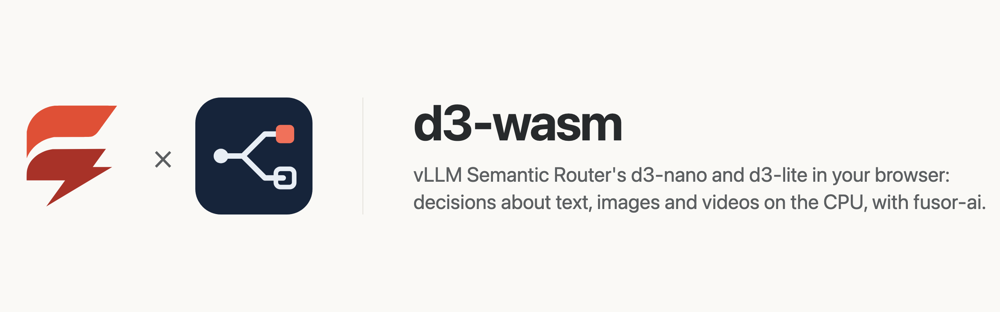
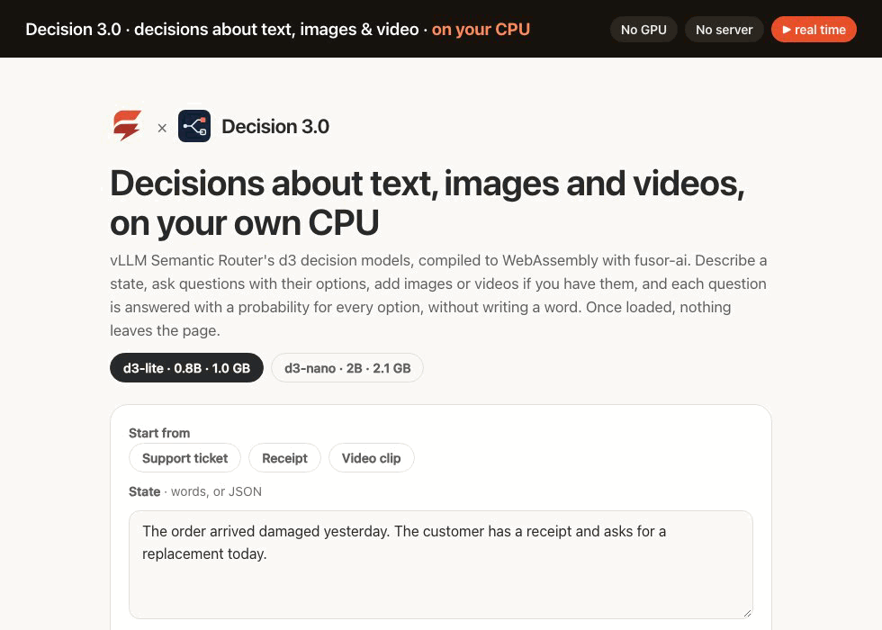
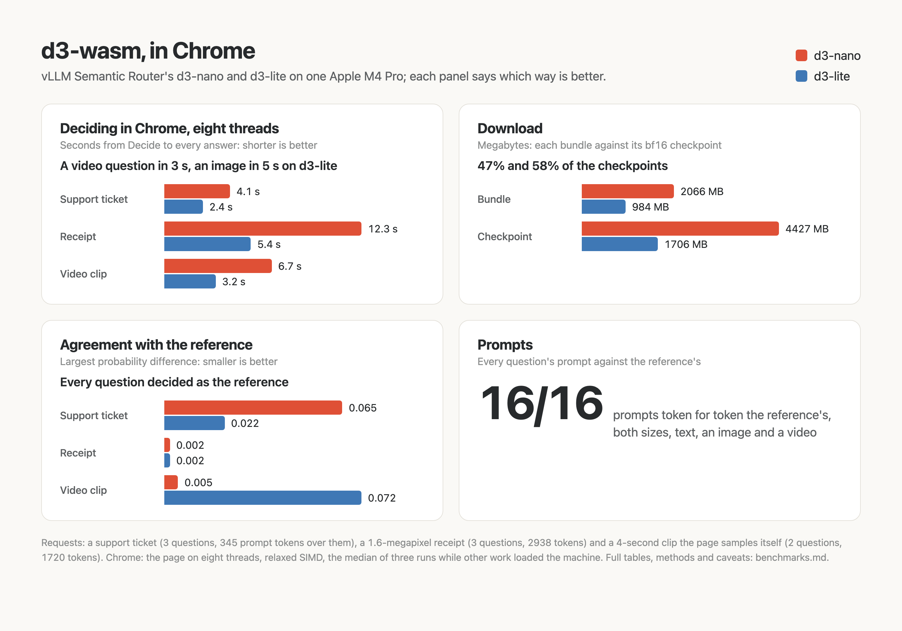

<p>
  <picture>
    <source media="(prefers-color-scheme: dark)" srcset="assets/brand/banner-dark.png">
    
  </picture>
</p>

# Decisions about text, images and videos in the browser, on the CPU

**[Try it in your browser](https://huggingface.co/spaces/fusorlabs/d3-wasm)**: no install, no server. The model downloads once and runs on your CPU.

**Three questions about a receipt photo decided in 5.4 s**, in Chrome on an Apple M4 Pro, eight threads, with d3-lite. [Benchmarks](benchmarks.md)

<a href="https://huggingface.co/spaces/fusorlabs/d3-wasm"></a>

Describe a situation, ask questions about it with their options, add images or videos if you have them, and get every answer with a probability for every option: vLLM Semantic Router's Decision 3.0 models, [d3-nano](https://huggingface.co/vllm-sr/d3-nano) (2B) and [d3-lite](https://huggingface.co/vllm-sr/d3-lite) (0.8B), computed on your own device. No server, no API key, no GPU required, and once the model has loaded, nothing you type or drop leaves the page.

d3-wasm is the app around the models: a [fusor](https://github.com/fusor-rs/fusor) page, the browser runtime and a native CLI. The models themselves, compiled to WebAssembly, are built with [fusor-ai](https://github.com/fusor-rs/fusor-ai), the toolkit for AI runtimes in Rust and WebAssembly, from the published weights.

**In development · v0.1**: this is experimental software. See [status and known limitations](#status-and-known-limitations).

[Run it](#run-it-locally) · [Try it online](#try-it-online) · [How it works](#how-it-works) · [How fast is it](#how-fast-is-it) · [Benchmarks](benchmarks.md) · [Status](#status-and-known-limitations)

## Run it locally

You need Rust 1.99 or newer, installed with [rustup](https://rustup.rs), Node.js 22 or newer and [`just`](https://github.com/casey/just). Then:

```sh
git clone --recurse-submodules https://github.com/fusor-rs/d3-wasm && cd d3-wasm
just ui
```

and open the address it prints. `just ui` installs the pinned tools (the threads toolchain with rustup; wasm-bindgen, binaryen and the fusor CLI into `.tools/`), downloads both checkpoints at pinned revisions (4.4 GB and 1.7 GB, each file sha256-checked), compiles them into a 2066 MB bundle for d3-nano and a 984 MB one for d3-lite, builds the four browser runtimes (a few minutes the first time, seconds after) and the page, and serves it on `http://localhost:8787` with the bundles beside it.

The page loads d3-lite; the switch under the title loads d3-nano instead. Start from an example (a support ticket, a receipt, a short video clip) or write your own: the **state** in words or as JSON, and the **questions** as a JSON object, each a `choice` among described options, a `score` on ordered levels, or a yes-or-no `noul`, as the model card describes them. Add images and videos by dropping, pasting or choosing them, and press **Decide**, even while the model is still loading: the request is decided the moment the model is ready. Each question comes back with every option's probability as a bar, a score with its expected level, and the response's JSON to copy. Every decision is measured live: the time from Decide to the answers, the prompt tokens read per second, the tokens of every question and of the media, and the network requests since the model loaded, which stay at zero.

## Try it online

Open the Hugging Face Space [fusorlabs/d3-wasm](https://huggingface.co/spaces/fusorlabs/d3-wasm) in Chrome or Edge. The page downloads the 984 MB model once and keeps it in the browser's storage, so the next visit loads in about a second. `?size=nano` loads the 2066 MB d3-nano instead of d3-lite.

## More ways to run it

### Build everything from source

```sh
just build    # also downloads the checkpoints (6.1 GB, sha256-checked) and compiles the bundles
just serve
```

`CHECKPOINTS=<dir>` reuses checkpoints you already have (`<dir>/checkpoint-nano`, `<dir>/checkpoint-lite`).

### The CLI

The CLI decides the requests of a JSON file without a browser, each as the reference's `system_one` takes it, its images' paths relative to `--media` and each video read as the frames `just media` extracts beside it:

```sh
target/release/d3 decide dist/model/lite fixtures/requests.json --media fixtures/media
```

`d3 bench` measures each stage on a request and `d3 parity` compares every stage with the reference's outputs.

## How it works

- **One forward pass per question, no generation.** Each question is its own prompt, as the checkpoint's own runtime renders it: a system prompt, the request's images and videos, the state, the question and every option under a single-token answer code (`A`, `B`, … `AA`, …). The language model reads it once, and a 255-way readout of the last row over the codes gives every option's probability.
- **The reference's prompt, token for token.** Options keep their order, a JSON state is written as Python's `json.dumps` writes it, and a video's frame pairs are placed after their times as the processor places them, so every prompt's ids are the reference's, one for one.
- **A hybrid language model that reads both ways.** Qwen3.5's 24 layers mix tokens two ways: every fourth with gated attention, here over the whole prompt in both directions, the others with the gated delta rule, a linear attention read left to right. fusor-ai's `hybrid` block runs both on the int8 kernels, the whole prompt in one call.
- **Images and videos as the model sees them.** An image is resized to whole 32-pixel blocks within 1.6 megapixels and cut into 16 × 16 patches of two frames, its own twice; a video is sampled at 2 frames a second (4 to 32 over its whole length), each two frames one patch's two, at up to 0.2 megapixels. A NaViT encoder reads each image and each frame pair, and a merger turns every 2 × 2 patches into one of the language model's tokens, placed by its row and column. They are read once per request, and every question sees them.
- **Videos decoded on the page.** The page samples a video itself, seeking its frames with the browser's own decoder at the frame rate it measures, so any video the browser plays can be asked about.
- **Quantized where it holds.** d3-nano's feed-forwards are 4-bit and everything else 7-bit, 2066 MB against its 4.4 GB checkpoint; d3-lite stays 7-bit, 984 MB, since its 4-bit feed-forwards move one of the fixtures' close calls across the line ([benchmarks](benchmarks.md#agreement-with-the-reference)).
- **One stage per step.** The engine worker decides in steps (each image and each frame pair through the vision tower, then each question) and posts each, so the page shows the progress and Stop takes effect between steps.
- **Threads and SIMD where the browser has them.** The page picks one of four builds: worker threads when it is cross-origin isolated, relaxed SIMD when the engine supports it, plain SIMD128 everywhere else.
- **Downloaded once, verified always.** Each bundle streams in parts, each checked against its BLAKE3 hash, and stays in the browser's origin-private storage, so the next visit loads from this device in a second or two.
- **Sealed.** The runtime imports no network, storage, clock or entropy capability; fusor-ai's import check proves it on every build. The page counts its network requests while it decides, and the count is zero.

## How fast is it

On an Apple M4 Pro in Chrome on eight threads, d3-lite answers three questions about a 1.6-megapixel receipt, 2938 prompt tokens over them, in 5.4 s, and two about a 4-second clip in 3.2 s; d3-nano in 12.3 s and 6.7 s. Every fixed question of both sizes is decided as the reference decides it. [benchmarks.md](benchmarks.md) has the full measurements:

<picture>
  <source media="(prefers-color-scheme: dark)" srcset="assets/benchmarks/benchmarks-dark.png">
  
</picture>

## Documentation

| Guide | Covers |
| --- | --- |
| [Benchmarks](benchmarks.md) | Time to the answers, agreement with the reference and download, and how to reproduce them |
| [AGENTS.md](AGENTS.md) | The code standard every change follows |

## Status and known limitations

d3-wasm is v0.1 and experimental.

| Platform or capability | Status |
| --- | --- |
| Chrome and Edge, threads and relaxed SIMD | Headless Chrome end-to-end check (`just e2e`, both sizes): decide while loading, an image, a video the page samples itself, revisit |
| Browsers without relaxed SIMD (Safari, older Firefox) | SIMD128 builds, checked in Node (`just smoke`) and Chrome; not tested in those browsers |
| Pages without cross-origin isolation | Single-threaded builds |
| Native CLI (macOS on Apple silicon) | Built and measured; no release archives yet |
| Phones | Not measured; the threaded builds' memory may grow to 4 GB with d3-nano |

**Not supported yet:**

- Prompts longer than 4096 tokens, the media's included: a longer question is answered `max_length_exceeded`; the reference takes any length.
- More than 8 images or 4 videos a request.
- Videos in formats the browser cannot decode (Chrome has no MPEG-4 Part 2 decoder, for one): convert them first. A video's frame rate is measured from the frames the browser presents, so a variable rate is read as its fastest.
- The reference's `permutation_average`, which also scores every choice with its options reversed.
- A GPU backend.

The models are vLLM Semantic Router's [d3-nano](https://huggingface.co/vllm-sr/d3-nano) and [d3-lite](https://huggingface.co/vllm-sr/d3-lite), under the Apache-2.0 license, built on Qwen's [Qwen3.5-2B](https://huggingface.co/Qwen/Qwen3.5-2B) and [Qwen3.5-0.8B](https://huggingface.co/Qwen/Qwen3.5-0.8B); each bundle ships the license and notice beside its weights (`model/<size>/LICENSE`, `NOTICE`). The example image and video are the model card's own (Apache-2.0), downloaded at a pinned revision; the video is also shipped as a lossless VP9 WebM the browser can decode.

## License

The code is licensed under the [MIT License](LICENSE). The models' weights are vLLM Semantic Router's, under [Apache-2.0](https://huggingface.co/vllm-sr/d3-nano/blob/main/LICENSE).
